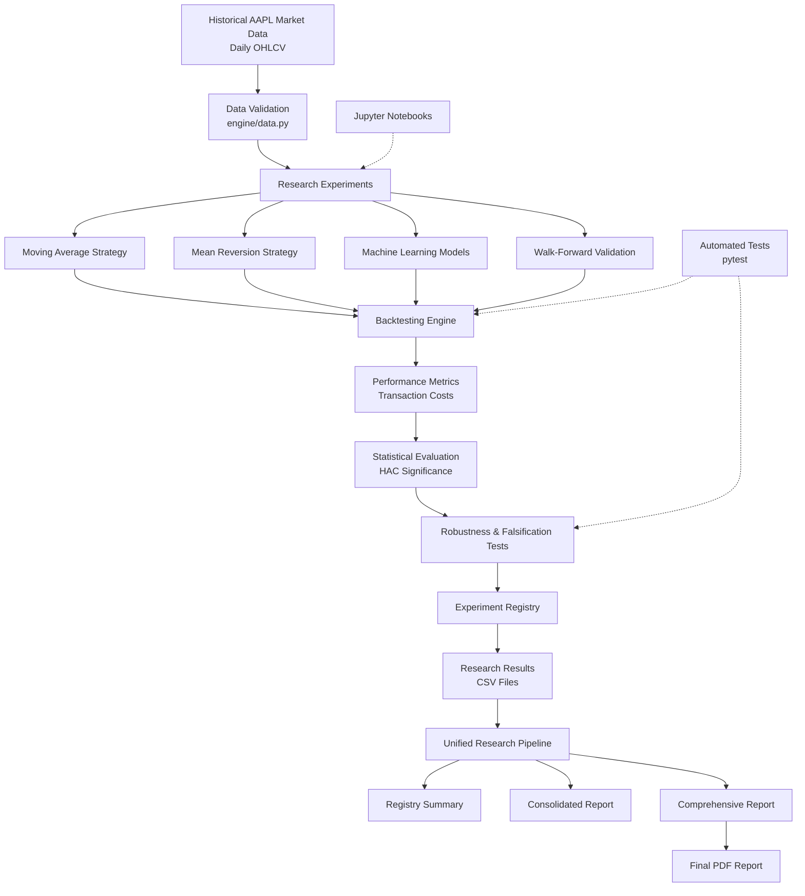

## System Architecture


# AI Quant Research Lab

**A quantitative research project focused on testing, evaluating, and attempting to falsify systematic trading strategies.**

## Overview

The AI Quant Research Lab is a Python-based quantitative research project designed to investigate whether systematic trading strategies demonstrate a measurable edge over a benchmark after accounting for execution timing, transaction costs, risk, and out-of-sample performance.

Rather than assuming a strategy works because it performs well historically, the project emphasizes disciplined experimentation, statistical evaluation, robustness testing, and rejection of unsupported trading hypotheses.

The central research principle is simple: **a strategy must provide evidence of an edge, not merely produce an attractive historical backtest.**

## Research Objectives

- Develop and evaluate systematic trading strategies.
- Separate parameter selection from out-of-sample evaluation.
- Model transaction costs and trading-position changes.
- Investigate execution timing and signal alignment.
- Compare strategy performance against buy-and-hold benchmarks.
- Evaluate risk using volatility, Sharpe ratio, and maximum drawdown.
- Use statistical testing to investigate whether excess returns are distinguishable from noise.
- Conduct robustness and transaction-cost sensitivity analyses.
- Record experimental results and rejection decisions in a research registry.

## Research Experiments

### 1. Moving-Average Strategy

Investigates whether moving-average trend signals can capture persistent price trends.

The strategy is evaluated against a buy-and-hold benchmark, with performance assessed through total return, risk-adjusted returns, and drawdown.

**Research outcome:** The tested strategy underperformed buy-and-hold over its registered evaluation period and was rejected.

### 2. Mean-Reversion Strategy — Close Execution

**Hypothesis:** Prices sufficiently below a rolling average may recover toward that average.

Parameters are selected using historical training data from 2021–2023 and evaluated on the separate 2024–2025 out-of-sample period.

The experiment evaluates performance using historical closing prices, transaction costs, and benchmark comparisons.

**Research outcome:** The strategy underperformed buy-and-hold and did not demonstrate statistically significant mean daily excess returns under the HAC-based test. The experiment was rejected.

### 3. Mean-Reversion Strategy — Open Execution

This experiment investigates the same mean-reversion hypothesis with a more explicit execution model.

Signals derived from the previous trading session's closing prices determine positions for subsequent open-to-open return intervals.

Parameters are selected using 2021–2023 data and evaluated on 2024–2025 data.

#### Out-of-Sample Results (2024–2025)

| Metric | Mean Reversion | Buy and Hold |
|---|---:|---:|
| Total Return | 11.50% | 47.28% |
| CAGR | 5.63% | 21.50% |
| Annualized Volatility | 17.21% | 29.90% |
| Sharpe Ratio | 0.402 | 0.800 |
| Maximum Drawdown | -13.44% | -33.33% |

**Transaction cost assumption:** 0.10% per unit of turnover.

#### Statistical Evaluation

The HAC-based test of mean daily excess returns produced a p-value of **0.3404**. This is not statistically significant at the 5% level.

#### Research Decision: REJECT

The strategy generated a positive return and experienced lower volatility and maximum drawdown than buy-and-hold. However, it underperformed the benchmark in total return and Sharpe ratio, and the statistical test did not establish significant mean daily excess returns.

The experiment therefore does not provide sufficient evidence of a benchmark-beating edge under the tested assumptions.

### 4. Machine-Learning Experiment

A logistic regression model was developed to investigate whether historical price-based features could help predict subsequent market direction.

Features included:

- Short- and medium-term returns
- Rolling volatility
- Price relative to moving averages
- Moving-average relationships

The experiment used a chronological training and testing split to avoid randomly mixing future observations into training data.

**Prediction results:**

- ROC AUC: 0.4661
- Accuracy: 0.4731
- Majority-class baseline accuracy: 0.5449

The model did not demonstrate useful predictive discrimination on the evaluated test sample.

The resulting trading strategy also underperformed buy-and-hold. Its total return was approximately -0.82%, compared with +47.83% for the benchmark.

### 5. Walk-Forward Validation

A walk-forward experiment evaluates model predictions through sequential historical training and testing rather than relying on a single static split.

The experiment investigates whether predictive performance remains consistent across successive evaluation periods.

The results did not establish reliable predictive superiority over the baseline, and the resulting strategy underperformed buy-and-hold.

### 6. Statistical and Robustness Analysis

Additional research utilities investigate whether observed results are sensitive to assumptions and individual market observations.

These include:

- HAC-based statistical significance testing.
- Ordinary t-tests as supplementary diagnostics.
- Transaction-cost stress testing.
- Parameter robustness analysis.
- Best-day dependency analysis.
- Extreme-day and market-regime analysis.

For the close-execution mean-reversion experiment, the transaction-cost stress test produced the following results:

| Cost per Turnover | Strategy Total Return |
|---:|---:|
| 0.00% | 10.93% |
| 0.05% | 9.82% |
| 0.10% | 8.72% |
| 0.25% | 5.50% |
| 0.50% | 0.32% |

Even with zero assumed transaction costs, the strategy underperformed buy-and-hold, which returned 42.54% over the same evaluation period.

## Experiment Registry

The project maintains an experiment registry to record strategy hypotheses, evaluation periods, performance metrics, statistical evidence, and research decisions.

The registry currently records three principal strategy experiments:

- Moving-average baseline
- Close-execution mean reversion
- Open-execution mean reversion

All three are currently marked **REJECT** based on their registered evaluation results.

Rejection does not establish that a strategy can never work. It indicates that the particular experiment did not establish sufficient evidence of an edge under its tested assumptions.

## Technology Stack

- **Python** — research implementation
- **pandas and NumPy** — data handling and numerical analysis
- **SciPy** — statistical calculations
- **statsmodels** — HAC statistical evaluation
- **scikit-learn** — machine-learning experiments
- **Matplotlib** — research visualizations
- **pytest** — automated testing
- **Jupyter Notebook** — exploratory analysis
- **yfinance** — historical market-data retrieval
- **ReportLab** — PDF report generation
- **Markdown** — Markdown-to-HTML conversion
- **BeautifulSoup** — HTML parsing for PDF generation

## Project Structure

```text
ai-quant-research-lab/
│
├── data/
│
├── engine/
│   ├── backtester.py
│   ├── backtester_open.py
│   ├── metrics.py
│   ├── robustness.py
│   ├── experiment_registry.py
│   ├── registry_summary.py
│   ├── generate_registry_report.py
│   ├── generate_final_report.py
│   ├── generate_pdf_report.py
│   ├── run_research_pipeline.py
│   └── test_*.py
│
├── notebooks/
│   ├── 01_exploratory_data_analysis.ipynb
│   ├── 02_strategy_backtesting.ipynb
│   ├── 03_machine_learning_experiment.ipynb
│   ├── 04_final_research_report.ipynb
│   └── 05_walk_forward_validation.ipynb
│
├── reports/
│   ├── experiment_registry.csv
│   ├── registry_summary.csv
│   ├── consolidated_research_report.md
│   ├── comprehensive_research_report.md
│   └── research outputs and visualizations
│
├── AI_Quant_Research_Lab_Final_Report_v2.pdf
├── .gitignore
├── requirements.txt
└── README.md
```

## Installation and Execution

Clone the repository and navigate to its root directory.

Install the dependencies:

```bash
python3 -m pip install -r requirements.txt
```

Run the research pipeline:

```bash
python3 -m engine.run_research_pipeline
```

The unified research pipeline validates the required research input files, regenerates the experiment registry summary, creates the consolidated registry report and comprehensive research report, and generates the final PDF research report.

The pipeline uses previously generated experiment results. It does not automatically rerun the individual strategy experiments or download new market data.

## Historical Data Requirements

The research experiments use historical daily OHLCV data for Apple Inc. (AAPL).

Two local datasets are required:

| Dataset | Date Range | Observations |
|---|---|---:|
| `aapl_daily.csv` | 2021-01-04 to 2025-12-31 | 1,255 |
| `aapl_daily_extended.csv` | 2021-01-04 to 2026-01-09 | 1,261 |

The datasets must be placed in the project's `data/` directory using the filenames above.

The CSV files are excluded from this public repository. Users must obtain the historical data independently and comply with the applicable data-provider terms.

The project uses `yfinance` for historical market-data retrieval. Newly downloaded data may differ slightly from the original research datasets, so exact reproduction of the reported results is not guaranteed.

## Research Report

The project generates a comprehensive research report in Markdown
and PDF formats.

- `reports/comprehensive_research_report.md`
- `AI_Quant_Research_Lab_Final_Report_v2.pdf`

## Automated Testing

The project uses pytest to validate backtesting logic, execution timing, transaction costs, input validation, registry summaries, and robustness utilities.

Run the complete test suite:

```bash
python3 -m pytest -v
```

**Latest verified test run: 19 tests passed using pytest 9.1.1 and Python 3.12.2.**

The automated tests are currently located in the `engine/` directory.

## Engineering and Research Practices

- Chronological training and out-of-sample separation.
- Parameter selection using training data.
- Explicit signal timing and open-to-open return calculations.
- Transaction-cost modeling.
- Benchmark comparisons.
- HAC statistical testing.
- Transaction-cost sensitivity analysis.
- Experiment registration and rejection tracking.
- Automated unit testing.
- Reproducible local historical datasets.

## Limitations

- Most current experiments focus on a single asset: AAPL.
- Historical performance does not guarantee future results.
- Transaction-cost assumptions do not fully represent bid-ask spreads, slippage, market impact, liquidity, or execution constraints.
- A limited asset universe and evaluation period cannot establish broad strategy robustness.
- Parameter selection and multiple strategy trials can introduce overfitting and selection bias.
- Statistical non-significance does not prove that a strategy has no edge.
- The current system is a research prototype, not production-ready trading infrastructure.

## Future Work

- Expand testing to multiple assets and market regimes.
- Improve transaction-cost, slippage, and market-impact modeling.
- Strengthen walk-forward and robustness testing.
- Investigate more sophisticated statistical and machine-learning models.
- Improve experiment-pipeline reproducibility.
- Develop a research dashboard for comparing strategies and tracking decisions.
- Explore more rigorous methods of controlling multiple-testing and selection bias.

## Disclaimer

This project is for educational and quantitative research purposes only. It is not financial advice or a recommendation to trade any security.
