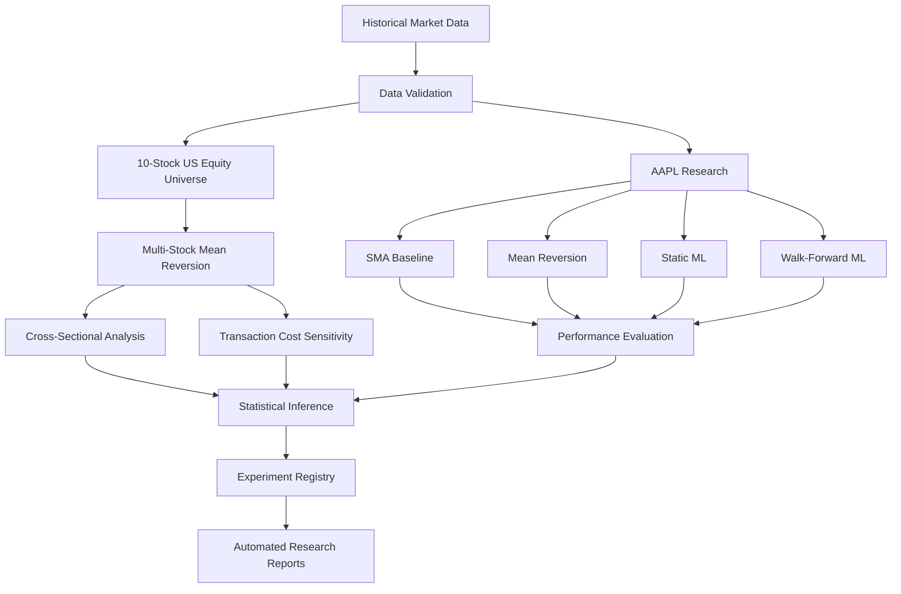

# AI Quant Research Lab
### A Research Framework for Testing and Falsifying Systematic Trading Strategies

A Python-based quantitative research project that develops, evaluates, and attempts to disprove systematic trading strategies using historical US equity data.

The project combines data validation, backtesting, transaction-cost modelling, out-of-sample evaluation, machine learning, walk-forward testing, cross-sectional analysis, and statistical inference.

**The central research principle: a strategy should demonstrate evidence of an edge—not simply produce an attractive historical backtest.**

> **Current research conclusion:** The strategies evaluated in this project did not establish a reliable positive edge over their respective benchmarks. All six registered experiments were rejected. The project treats these negative results as research findings rather than attempting to present them as successful trading strategies.

---

## 1. Project Overview

Many trading strategies appear profitable when evaluated on historical data. However, apparent performance can result from overfitting, data leakage, unrealistic execution assumptions, transaction costs, or market-specific behaviour.

This project was designed to investigate those problems.

It began with an Apple (AAPL) research pipeline and was subsequently expanded into a ten-stock US equity study. The framework evaluates both rule-based strategies and machine-learning approaches, with particular attention to out-of-sample performance and statistical evidence.

The research currently covers:

- Historical market-data validation.
- Simple moving-average strategy baselines.
- Mean-reversion strategies using close-based and open-based execution.
- Logistic-regression classification for next-session market direction.
- Expanding-window walk-forward machine learning.
- Cross-sectional evaluation across ten US stocks.
- Transaction-cost sensitivity analysis.
- Newey-West heteroskedasticity and autocorrelation-consistent (HAC) inference.
- Multiple-testing correction using the Holm procedure.
- Automated experiment registration and research reporting.

## 2. Research Universe

The multi-stock study uses ten US-listed equities across five broad sector classifications.

| Ticker | Company | Sector |
|---|---|---|
| AAPL | Apple | Technology |
| MSFT | Microsoft | Technology |
| NVDA | NVIDIA | Technology |
| GOOGL | Alphabet | Technology |
| AMZN | Amazon | Consumer |
| WMT | Walmart | Consumer |
| JPM | JPMorgan Chase | Financials |
| GS | Goldman Sachs | Financials |
| XOM | Exxon Mobil | Energy |
| JNJ | Johnson & Johnson | Healthcare |

The datasets contain 1,261 daily observations per stock, covering 4 January 2021 to 9 January 2026.

The principal out-of-sample evaluation period is 2024–2025.

**Important universe limitation:** This is a selected research universe, not a point-in-time historical index constituent universe. It does not eliminate survivorship or selection bias. The sector sample sizes are also small, so sector-level results should not be interpreted as broad sector conclusions.

## 3. Research Architecture

The framework separates data preparation, strategy evaluation, statistical analysis, and reporting.



## 4. Key Research Findings

### 4.1 Multi-Stock Mean-Reversion Evaluation

A mean-reversion strategy was configured using parameters selected on AAPL training data:

- Lookback window: 20 sessions.
- Entry threshold: −5%.
- Transaction cost: 0.10% per turnover.
- Signal generation: previous-session closing information.
- Execution and return measurement: open-to-open.
- Out-of-sample period: 2024–2025.

The same parameters were applied across all ten stocks.

**Result: 0 out of 10 stocks outperformed their respective buy-and-hold benchmarks in total return.**

| Cross-sectional measure | Strategy | Buy and hold |
|---|---:|---:|
| Mean total return | 19.72% | 97.46% |
| Median total return | 9.41% | 77.12% |
| Mean Sharpe ratio | 0.491 | 1.211 |
| Median Sharpe ratio | 0.426 | 1.231 |
| Mean maximum drawdown | −10.07% | −28.00% |

The strategy generally experienced smaller drawdowns, but this came with substantially lower returns and weaker risk-adjusted performance.

The lower drawdown should therefore not be interpreted as evidence of superior overall performance.

### 4.2 Transaction-Cost Sensitivity

The strategy was evaluated at five transaction-cost assumptions.

| Cost per turnover | Mean strategy return | Stocks beating benchmark |
|---:|---:|---:|
| 0.00% | 22.02% | 0/10 |
| 0.05% | 20.86% | 0/10 |
| 0.10% | 19.72% | 0/10 |
| 0.25% | 16.37% | 0/10 |
| 0.50% | 11.06% | 0/10 |

Even with transaction costs set to zero, none of the ten stocks outperformed its benchmark.

This suggests that transaction costs were not the sole explanation for the strategy's underperformance.

### 4.3 Portfolio-Level Statistical Evaluation

An equal-weighted daily rebalanced portfolio was constructed from the ten stocks.

| Metric | Strategy portfolio | Benchmark portfolio |
|---|---:|---:|
| Total return | 17.69% | 97.34% |
| Sharpe ratio | 0.8649 | 1.9342 |
| Maximum drawdown | −5.39% | −22.45% |

The benchmark is an equal-weighted daily rebalanced basket, not a fixed-quantity buy-and-hold portfolio.

A Newey-West HAC test was conducted on the portfolio's daily arithmetic excess returns.

| Statistical measure | Result |
|---|---:|
| Observations | 501 |
| Mean daily excess return | −0.001081 |
| HAC standard error | 0.000412 |
| HAC t-statistic | −2.6259 |
| HAC p-value | 0.008642 |
| 95% confidence interval | [−0.001888, −0.000274] |

The estimated mean excess return was statistically significantly negative at the 5% level.

This is evidence of underperformance relative to the benchmark under the tested assumptions—not evidence of a profitable strategy.

The conclusion remained statistically significant across HAC lag choices of 1, 5, 10, and 20.

### 4.4 Individual-Stock Statistical Testing

Individual stock-level tests used Newey-West HAC standard errors and Holm adjustment across ten tests.

Walmart was the only individual stock with a statistically significant result after Holm correction (adjusted p-value: 0.040052).

The estimated result was negative relative to the benchmark. It should not be interpreted as evidence of a positive trading edge.

---

## 5. AAPL Research Experiments

The original AAPL research pipeline remains part of the project.

| Experiment | Main out-of-sample result | Decision |
|---|---|---|
| SMA baseline | Total return 33.15% vs 115.81% buy and hold | REJECT |
| Mean reversion — close execution | 8.72% vs 42.54% buy and hold | REJECT |
| Mean reversion — open execution | 11.50% vs 47.28% buy and hold | REJECT |
| Static logistic regression | Approximately −0.82% vs 47.83% buy and hold | REJECT |
| Walk-forward logistic regression | 13.00% vs 47.83% buy and hold | REJECT |
| Ten-stock equal-weighted portfolio | 17.69% vs 97.34% benchmark | REJECT |

### Machine-Learning Evaluation

The project includes two logistic-regression experiments.

**Static model**

- Uses historical return, volatility, and moving-average-derived features.
- Trains on data before 2024.
- Evaluates on the 2024–2025 test period.
- Excludes training observations whose target dates overlap the test period.

Test results included:

- ROC AUC: 0.4662.
- Brier score: 0.2587.
- Baseline Brier score: 0.2484.

The model did not demonstrate useful predictive performance against the baseline.

**Expanding-window walk-forward model**

The model is retrained sequentially using only labels available at each test date.

Test results included:

- Accuracy: 0.5130.
- ROC AUC: 0.4469.
- Brier score: 0.2542.
- Expanding historical-rate Brier baseline: 0.2485.

The resulting strategy returned approximately 13.00%, compared with 47.83% for buy and hold.

Neither ML experiment established a convincing predictive or investment edge.

---

## 6. Statistical and Research Methodology

The project uses several safeguards to make historical strategy evaluation more rigorous.

**Out-of-sample testing**

Strategy parameters are selected using training data and evaluated on a separate test period. The principal OOS period for the reported experiments is 2024–2025.

**Execution-aware backtesting**

The open-based mean-reversion implementation uses previous-session information to generate signals and measures subsequent open-to-open returns. This avoids treating information from the current session's close as if it were available at the same session's opening price.

**Transaction-cost modelling**

Returns are adjusted for an explicit transaction-cost assumption. Cost-sensitivity experiments examine whether conclusions change under alternative assumptions.

**Walk-forward validation**

The expanding-window ML experiment retrains sequentially using information available at each prediction date.

**HAC statistical inference**

Newey-West HAC standard errors account for heteroskedasticity and autocorrelation in daily return observations.

**Multiple-testing correction**

Holm adjustment is applied to the ten individual-stock statistical tests.

**Experiment registry**

Experiments are recorded with their configurations, performance metrics, statistical results, and research decisions. This makes it easier to compare results and avoid presenting only favourable experiments.

---

## 7. Technology Stack

| Technology | Application |
|---|---|
| Python | Research and experiment orchestration |
| pandas | Financial time-series manipulation |
| NumPy | Numerical computation |
| SciPy | Statistical computation |
| statsmodels | HAC statistical inference |
| scikit-learn | Logistic regression and ML evaluation |
| Matplotlib | Research visualisations |
| yfinance | Historical market-data acquisition |
| pytest | Automated testing |
| Markdown | Research reporting |
| ReportLab | PDF report generation |

---

## 8. Repository Structure

The repository is organised by research responsibility.

```text
ai-quant-research-lab/
│
├── config/
│   └── stock_universe.csv
│
├── data/
│   ├── build_adjusted_price_snapshot.py
│   ├── download_multi_stock_data.py
│   ├── validate_market_data.py
│   ├── validate_multi_stock_data.py
│   └── multi_stock/
│
├── engine/
│   ├── backtester.py
│   ├── backtester_open.py
│   ├── metrics.py
│   ├── experiment_registry.py
│   ├── run_mean_reversion_open_oos.py
│   ├── run_multi_stock_mean_reversion.py
│   ├── run_ml_experiment.py
│   ├── run_walk_forward_experiment.py
│   ├── analyze_multi_stock_results.py
│   ├── analyze_multi_stock_cost_sensitivity.py
│   ├── analyze_multi_stock_significance.py
│   ├── run_research_pipeline.py
│   ├── test_*.py
│   └── ...
│
├── notebooks/
│
├── reports/
│   ├── experiment_registry.csv
│   ├── multi_stock_mean_reversion_open_summary.csv
│   ├── multi_stock_hac_significance.csv
│   ├── multi_stock_portfolio_hac_significance.csv
│   ├── comprehensive_research_report.md
│   └── ...
│
├── README.md
├── requirements.txt
└── AI_Quant_Research_Lab_Final_Report_v2.pdf
```

Market-data CSV files are maintained locally and excluded from Git. Generated research reports and selected analysis outputs are maintained in the repository.

## 9. Running the Project

### Requirements

- Python 3.12 or compatible Python environment.
- Git.
- Internet access for downloading market data.
- The dependencies listed in `requirements.txt`.

### Installation

Clone the repository:

```bash
git clone https://github.com/Ash-Win-daft/ai-quant-research-lab.git
cd ai-quant-research-lab
```

Install dependencies:

```bash
python3 -m pip install -r requirements.txt
```

### Market Data Preparation

Raw market-data CSV files are excluded from Git because they are local research inputs.

Download the configured multi-stock datasets:

```bash
python3 -m data.download_multi_stock_data
```

Validate the downloaded datasets:

```bash
python3 -m data.validate_multi_stock_data
```

The AAPL research pipeline requires three local input files:

- `data/aapl_daily.csv`
- `data/aapl_daily_extended.csv`
- `data/aapl_adjusted_close.csv`

The adjusted-close snapshot can be downloaded separately using:

```bash
python3 -m data.build_adjusted_price_snapshot
```

This command creates only `aapl_adjusted_close.csv`. It does not generate the two AAPL OHLC datasets.

The snapshot builder refuses to overwrite an existing file. Run it only when the snapshot is missing and you intentionally want to create it.

Make sure all three AAPL input files are present before executing the complete research pipeline.

**Data note:** Multi-stock OHLC data is downloaded using yfinance with automatic price adjustment enabled. Historical data availability and provider adjustments can change, so independently downloaded datasets may not reproduce every result exactly.

### Run the Unified Research Pipeline

```bash
python3 -m engine.run_research_pipeline
```

The unified pipeline validates inputs, runs the configured ML and multi-stock experiments and analysis stages, synchronizes the experiment registry, and generates the consolidated and comprehensive reports. Existing AAPL research outputs are required as inputs.

### Run Tests

```bash
python3 -m pytest -v
```

The current project test suite contains 19 passing tests.

**Data note:** Historical prices are obtained through yfinance. Provider availability and adjusted historical data can change, so independently downloading the data may not reproduce every historical output byte-for-byte.

---

## 10. Limitations

The results should be interpreted within the scope of the research design.

1. **Limited universe:** Ten selected stocks are not representative of the entire US equity market.
2. **Survivorship and selection bias:** The universe is not reconstructed using point-in-time historical constituents.
3. **Small sector samples:** Sector-level comparisons are descriptive, not generalisable conclusions.
4. **Simplified execution costs:** The transaction-cost model does not fully represent bid-ask spreads, market impact, liquidity constraints, or order execution uncertainty.
5. **Adjusted-price assumptions:** The multi-stock data uses auto-adjusted OHLC prices. These are useful for historical analysis but do not represent executable historical market prices.
6. **Limited strategy family:** The tested strategies do not cover the full range of systematic trading approaches.
7. **Historical dependence:** Results from 2024–2025 cannot establish future performance.
8. **Portfolio construction:** The equal-weighted daily rebalanced portfolio is a research benchmark, not a complete portfolio-management or risk-budgeting system.

The project is a quantitative research prototype, not production trading infrastructure or investment advice.

---

## 11. Future Research Directions

Potential extensions include:

- Point-in-time universe construction to address survivorship bias.
- Broader and more diverse equity universes.
- Market microstructure and order-book analysis.
- More realistic execution, spread, slippage, and market-impact models.
- Volatility and market-regime classification.
- Probabilistic forecasting and improved financial time-series ML.
- Portfolio optimisation and risk allocation.
- More extensive robustness testing across different market regimes.

These extensions would build on the existing research framework rather than treating the current rejected strategies as successful trading systems.

---

## 12. Final Research Perspective

The objective of this project was not to manufacture a profitable backtest.

It was to build a research process capable of testing trading hypotheses, measuring their performance under explicit assumptions, and rejecting them when the evidence did not support them.

Across six registered experiments, the strategies failed to establish a reliable positive edge over their respective benchmarks.

The multi-stock expansion made that conclusion more informative: the underperformance persisted across the selected ten-stock universe, remained under zero transaction costs, and was statistically significant at the equal-weighted portfolio level in the tested period.

**A credible quantitative research process must be willing to reject its own strategies.**

That principle is the foundation of this project..