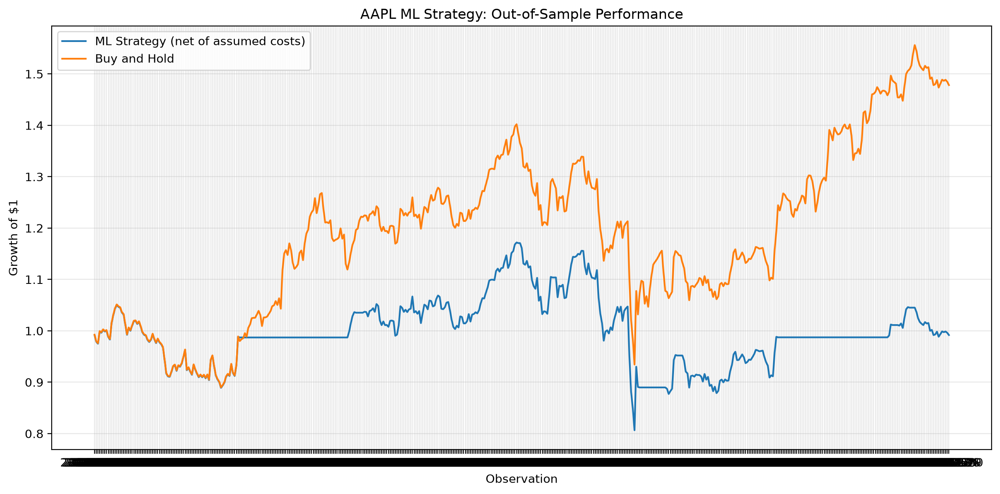

# AI Quant Research Lab
## Research Report: Strategy Testing and Falsification

**Generated:** 2026-10-21

## 1. Research objective

This project evaluates whether systematic trading signals and a machine-learning
model can produce useful out-of-sample results after accounting for risk and
assumed transaction costs. The research compares strategies with Buy and Hold
and examines sensitivity to model and trading assumptions.

## 2. Moving-average strategy: backtest comparison

|                             |   Strategy (Net of Costs) |   Buy and Hold |
|:----------------------------|--------------------------:|---------------:|
| Total Return                |                  0.265364 |       0.425375 |
| CAGR                        |                  0.125412 |       0.194734 |
| Annualized Volatility       |                  0.185166 |       0.27987  |
| Sharpe Ratio (0% risk-free) |                  0.730358 |       0.774223 |
| Maximum Drawdown            |                 -0.250303 |      -0.333605 |

The moving-average strategy produced a lower total return than Buy and Hold in
the reported comparison. It also had lower annualized volatility and a smaller
maximum drawdown. Its Sharpe ratio was slightly lower, so the strategy did not
improve every measure of risk-adjusted performance.

## 3. Machine-learning prediction evaluation

| Model                   |   Accuracy |   Balanced Accuracy |   Precision |   Recall |    ROC AUC |
|:------------------------|-----------:|--------------------:|------------:|---------:|-----------:|
| Logistic Regression     |   0.473054 |            0.458285 |    0.513595 | 0.622711 |   0.466069 |
| Training Majority Class |   0.54491  |            0.5      |    0.54491  | 1        | nan        |
| Always Predict Up       |   0.54491  |            0.5      |    0.54491  | 1        | nan        |

The Logistic Regression model achieved 47.3% accuracy and a ROC AUC of
approximately 0.466. It did not demonstrate convincing predictive skill on
this test set. Its accuracy was below the simple majority-class baseline, which
is an important warning against assuming that a trained model has predictive
value simply because it produces predictions.

## 4. Machine-learning strategy performance

|                             |   ML Strategy |   Buy and Hold |
|:----------------------------|--------------:|---------------:|
| Total Return                |   -0.00820649 |       0.478278 |
| CAGR                        |   -0.00413627 |       0.217268 |
| Annualized Volatility       |    0.236402   |       0.278937 |
| Sharpe Ratio (0% risk-free) |    0.0989691  |       0.842896 |
| Maximum Drawdown            |   -0.311819   |      -0.333605 |

The ML strategy underperformed Buy and Hold on total return, CAGR, and Sharpe
ratio in the reported out-of-sample comparison. Its maximum drawdown was also
slightly smaller in magnitude, but that alone does not compensate for its weak
return and Sharpe results.

## 5. Transaction-cost sensitivity

|    |   Unnamed: 0 |   One-way cost |   Total return |      CAGR |   Sharpe ratio |   Maximum drawdown |
|---:|-------------:|---------------:|---------------:|----------:|---------------:|-------------------:|
|  0 |            0 |         0      |       0.280617 | 0.132201  |       0.762751 |          -0.245804 |
|  1 |            1 |         0.001  |       0.265364 | 0.125412  |       0.730358 |          -0.250303 |
|  2 |            2 |         0.0025 |       0.242798 | 0.115291  |       0.681526 |          -0.25701  |
|  3 |            3 |         0.005  |       0.206005 | 0.0985923 |       0.599635 |          -0.268077 |

Performance weakened as the assumed one-way transaction cost increased. This
shows why transaction costs must be included in backtests rather than judging a
strategy using gross returns alone.

## 6. Moving-average robustness tests

|    |   Unnamed: 0 |   Short MA |   Long MA |   Strategy Return |   Strategy CAGR |   Strategy Sharpe |   Strategy Max Drawdown |   Benchmark Return |   Number of Position Changes |
|---:|-------------:|-----------:|----------:|------------------:|----------------:|------------------:|------------------------:|-------------------:|-----------------------------:|
|  0 |            0 |         10 |        30 |          0.222979 |       0.0469316 |          0.340794 |               -0.279486 |              0.893 |                           41 |
|  1 |            1 |         20 |        50 |          0.298836 |       0.0613854 |          0.415701 |               -0.298002 |              0.893 |                           26 |
|  2 |            2 |         30 |       100 |          0.332407 |       0.0675748 |          0.437199 |               -0.314078 |              0.893 |                           12 |
|  3 |            3 |         50 |       150 |          0.117885 |       0.0257161 |          0.227477 |               -0.284007 |              0.893 |                           11 |

Results varied across moving-average parameter choices. The best-performing
parameter combination in this table should not automatically be treated as
the best future strategy: selecting parameters after examining the same
historical period can introduce selection bias.

## 7. Limitations

- Historical performance does not guarantee future performance.
- The results depend on the chosen asset, test period, features, and assumptions.
- The ML model's weak evaluation metrics do not support a claim of reliable
  directional prediction.
- Transaction-cost estimates may not capture all slippage, liquidity, and
  execution effects.
- Further work should use strict walk-forward validation, realistic execution
  assumptions, and controls for data leakage and repeated strategy selection.

## 8. Conclusion

The experiments illustrate the importance of trying to falsify trading
strategies rather than accepting attractive historical results at face value.
The moving-average strategy's results were sensitive to assumptions and did
not consistently beat Buy and Hold. The ML experiment performed poorly against
its benchmark and simple prediction baselines.

**Current research verdict:** the tested ML approach is not supported as a
profitable trading strategy by these results. The next step is not to deploy it,
but to investigate the causes of weak predictive performance and evaluate
carefully designed alternatives on genuinely unseen data.

## Walk-Forward Validation (2024–2025)

### Methodology
A logistic regression model was retrained for each of 501
test sessions from January 2, 2024, through December 30, 2025.
The model used eight price-derived features and expanding
historical training data. Predictions were evaluated against
the subsequent trading session's return.

The simulation used a 0.1% transaction-cost assumption per
unit of turnover. Results are simplified historical simulations,
not live trading results.

### Predictive Performance
- Accuracy: 0.5130
- Balanced accuracy: 0.4848
- ROC AUC: 0.4469
- Brier score: 0.2542
- Historical-rate baseline Brier score: 0.2485

### Strategy Performance
- Walk-forward strategy total return: 13.00%
- Buy-and-hold total return: 47.83%
- Walk-forward strategy CAGR: 6.34%
- Buy-and-hold CAGR: 21.73%
- Walk-forward strategy Sharpe ratio: 0.3676
- Buy-and-hold Sharpe ratio: 0.8429

### Research Conclusion
The model did not demonstrate predictive or investment
performance superior to the simple benchmarks used in this
experiment. Accuracy was below the majority-class reference,
ROC AUC was below 0.50, and the Brier score was worse than
the historical-rate baseline.

The strategy also underperformed buy-and-hold in total return
and Sharpe ratio. These findings do not establish that all
machine-learning approaches are ineffective; they indicate
that this particular model and feature set did not demonstrate
an advantage in this test.

### Limitations
The experiment uses one asset, adjusted closing prices, a
simplified transaction-cost assumption, and close-to-close
returns. It does not model realistic order execution, spreads,
slippage, taxes, or market impact. Further research should
consider execution timing, benchmark robustness, and whether
any future improvements persist on untouched data.
